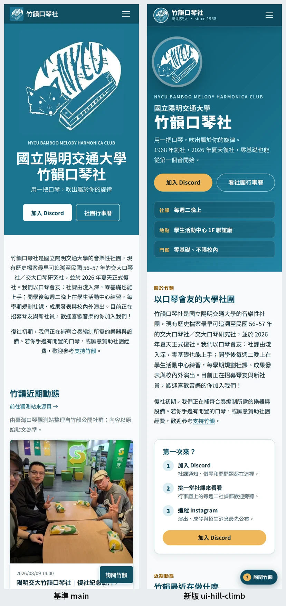
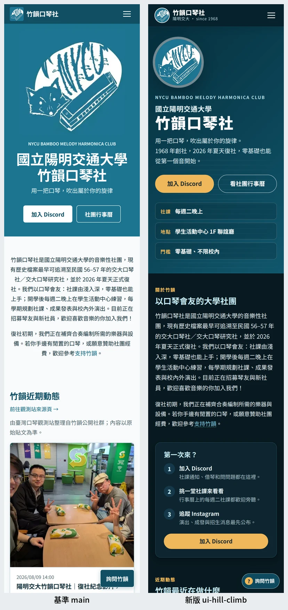
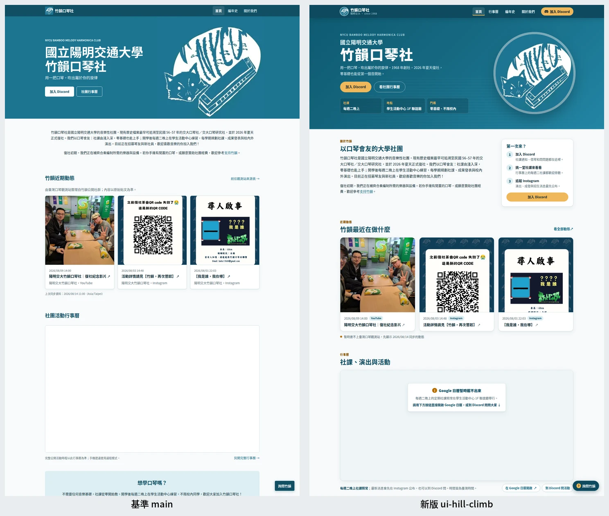
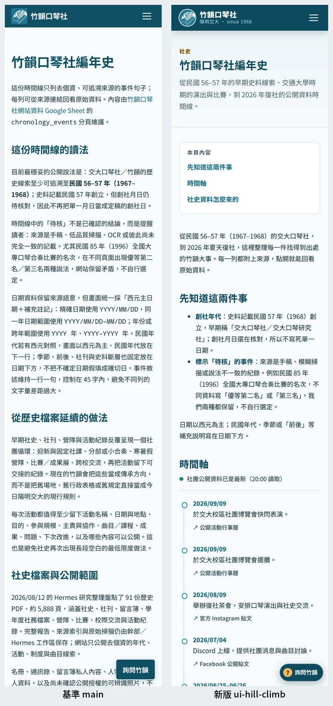
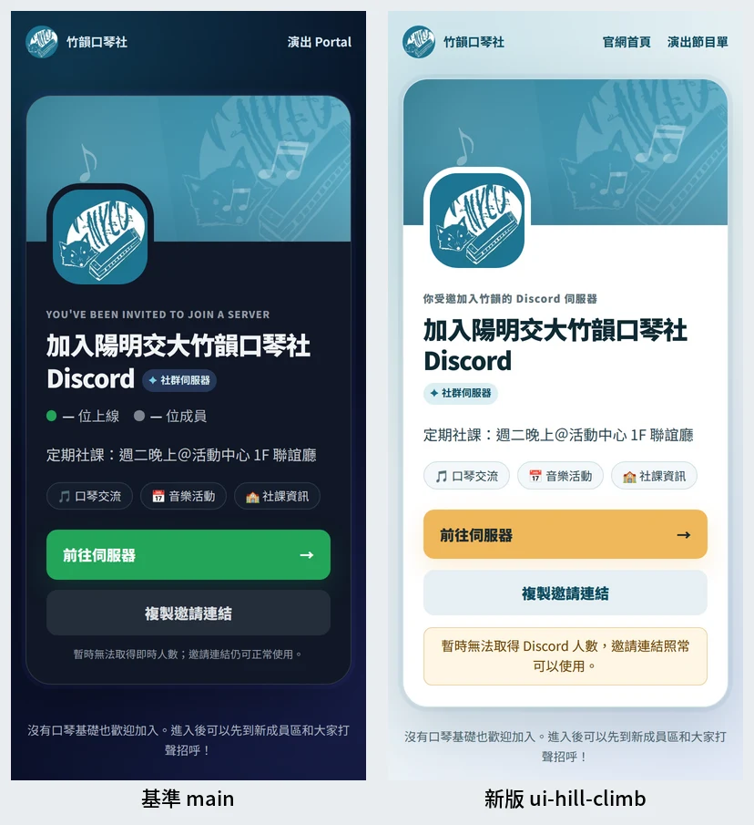
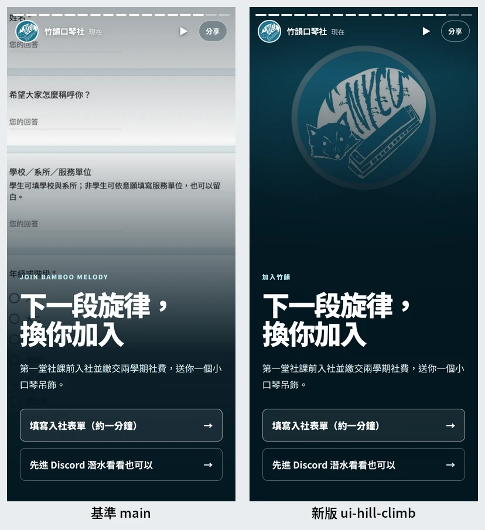
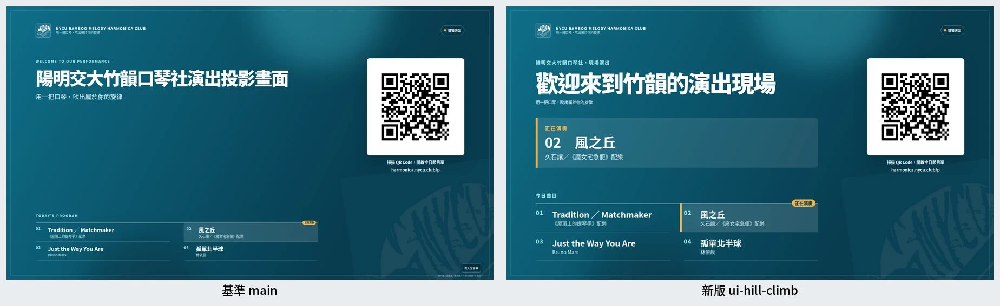

# 竹韻官網 UI hill climb 結果（2026-11-13）

流程沿用口琴觀測站的設計評審：`../brief.md` 第 1 輪定稿後不再改動（每輪 SHA-256 `f405092d…0f46` 相同），`../states.md` 是截圖清單。每輪都開全新的 Claude Opus 5.5（effort high）評審，盲測 A／B／C：基準＝`origin/main`（`9e459c9`）、新版＝當輪的 `ui-hill-climb`、參考＝Yale Glee Club、CUMS、銘傳大學口琴社。每組 73 張（參考 12 張），外部資料一律攔截並回凍結 fixture。

每輪評審原文：`r1-opus-5-5.md` … `r10-opus-5-5.md`；解盲後的分數：`scores.json`。

## 分數

整體＝評審給的整體分數；平均＝12 個項目分數的算術平均。

| 輪 | 基準 整體／平均 | 新版 整體／平均 | 參考 整體／平均 | 新版−基準（整體） |
|---|---|---|---|---:|
| 1 | 5.5／5.75 | 7.5／7.38 | 4.5／4.75 | +2.0 |
| 2 | 5.8／5.75 | 7.6／7.54 | 4.7／4.67 | +1.8 |
| 3 | 5.5／5.62 | 8.0／7.96 | 5.0／4.96 | +2.5 |
| 4 | 6.4／6.00 | 8.4／8.38 | 5.0／4.92 | +2.0 |
| 5 | 5.5／5.58 | 8.0／8.04 | 7.0／6.67 | +2.5 |
| 6 | 5.8／5.88 | 8.3／8.29 | 5.2／5.25 | +2.5 |
| 7 | 5.7／5.79 | 8.2／8.12 | 4.6／4.54 | +2.5 |
| 8 | 5.5／4.92 | 8.0／8.00 | 4.5／4.58 | +2.5 |
| 9 | 6.0／5.58 | 8.0／8.00 | 5.5／5.75 | +2.0 |
| 10 | 5.8／5.79 | 8.4／8.29 | 5.4／5.42 | +2.6 |

新版從沒有達到 ≥ 9，所以沒有觸發 council；階段 1 依上限停在第 10 輪。

## 膨脹與漂移觀察

- **基準沒有改，分數卻在 5.5–6.4 之間浮動**：第 4 輪整體 6.4、第 8 輪平均 4.92，同一組圖相差將近 1.5 分。單輪的新版分數變動（例如第 4 輪 8.4 → 第 5 輪 8.0）落在這個雜訊範圍內，不能當成改善或退步。
- **參考組第 5 輪從 5.0 跳到 7.0**：那一輪的評審把參考組當成「成熟的內容型網站」，也沒有扣它缺少的狀態截圖；其他九輪都在 4.5–5.7。記為單輪評審漂移。
- **同一個殘留問題每輪的排序都不同**：例如行事曆英文長地址在第 3 輪排第 5、第 10 輪排第 2，畫面本身沒有變。修改前都先回 1:1 原圖確認問題確實存在。
- **比較穩定的是差值**：新版−基準的整體差值十輪都在 +1.8 到 +2.6 之間，平均差值在 +1.6 到 +3.1 之間。新版平均分在第 3 輪之後停在約 8.0–8.4，之後的輪次主要是在消除同一批殘留問題，邊際效益很小。

## 截圖工具修正（會影響比較的部分）

- 第 1 輪後：空行事曆原本只錄了 HTML，事件請求不在錄製檔內，畫面變成 Google 的錯誤提示；改為完整錄製並重拍基準 `home-empty`。
- 第 4 輪後：空行事曆改成重播正常錄製並清空 events，不再出現「2099 年」字樣；重拍基準 `home-empty`。
- `/join/` 的截圖只移除 HTML 裡的轉址指令，畫面本身不變。

## 最後一輪仍指出、這次沒有處理的問題

- **Google 日曆每列重複英文長地址**：這是日曆活動的「地點」欄內容，要在 Google 日曆端把地點改短（例如「活動中心 1F 聯誼廳」），網站無法改 iframe 內容。
- **日曆沒有活動時是 Google 自己的空畫面**：跨網域 iframe 無法判斷「沒有活動」或「載入失敗」（錯誤頁也會觸發 `load`），所以只能在日曆下方常駐一句「每週二晚上社課照常」與兩個按鈕。
- **手機右下「詢問竹韻」浮動按鈕仍可能壓到內文**：已經做到往下捲時收起、頁尾出現時讓位；靜態截圖仍會拍到它停在內文上。
- **頁首副標偶有孤字、編年史桌面左欄下方留白**：屬於細節，沒有在最後一輪之後再做未經評審的修改。

## 前後對照（左：基準 main，右：新版）

